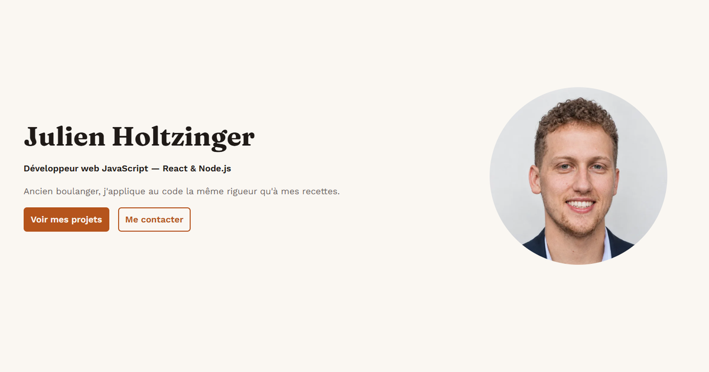

# Portfolio — Julien Holtzinger

Site portfolio de développeur web présentant mes projets, mes compétences et mon parcours de reconversion, développé avec React, Vite et Sass.

🔗 **Site en ligne : [julien-holtzinger.vercel.app](https://julien-holtzinger.vercel.app/)**



## Technologies

- **React** — composants, `useState`, `useEffect`, `useRef`
- **Vite** — outil de build et serveur de développement
- **Sass** — variables, imbrication, convention BEM, approche mobile-first
- **Vercel** — hébergement et déploiement continu depuis la branche `main`

## Fonctionnalités

- Design responsive mobile-first (breakpoints à 768px et 1024px)
- Navigation avec menu burger accessible sur mobile (`aria-expanded`, `aria-label`)
- Cartes projets générées à partir de données centralisées (`src/data/`)
- Modale projet accessible : fermeture avec Échap, clic sur l'overlay ou bouton, focus géré, défilement de la page bloqué
- Images optimisées en WebP avec chargement différé (`loading="lazy"`)
- SEO : balises meta, hiérarchie des titres, balises Open Graph pour le partage sur les réseaux sociaux

## Qualité

- **Lighthouse** : 100 en Performances, Accessibilité, Bonnes pratiques et SEO
- **WAVE** : 0 erreur, 0 erreur de contraste
- Navigation complète au clavier

## Installation

Prérequis : [Node.js](https://nodejs.org/) 20 ou plus.

```bash
# Cloner le dépôt
git clone https://github.com/Alzorath57/portfolio.git
cd portfolio

# Installer les dépendances
npm install

# Lancer le serveur de développement
npm run dev
```

Autres commandes :

```bash
npm run build     # Créer la version de production dans dist/
npm run preview   # Prévisualiser la version de production
```

## Structure du projet

```
portfolio/
├── public/              # Fichiers servis tels quels (favicon, image Open Graph)
├── src/
│   ├── assets/images/   # Captures des projets, photo, illustration
│   ├── components/      # Un dossier par composant (.jsx + .scss)
│   ├── data/            # Données des projets et des compétences
│   ├── styles/          # Variables et styles globaux Sass
│   ├── App.jsx
│   └── main.jsx
└── index.html
```

## Auteur

**Julien Holtzinger** — Développeur web React / Node.js

- [LinkedIn](https://www.linkedin.com/in/julien-holtzinger)
- [GitHub](https://github.com/Alzorath57)

Projet réalisé dans le cadre de la formation Développeur Web d'OpenClassrooms.
